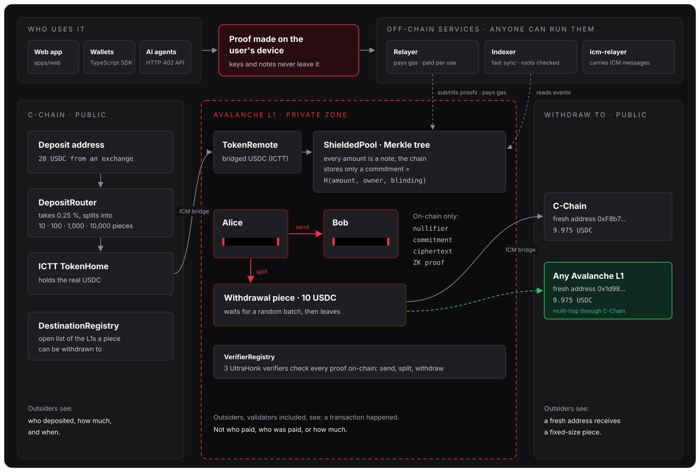

<p align="center"></p>

<h3 align="center">Private transactions for any asset on Avalanche.</h3>

<p align="center">
A privacy transaction layer for everyone on Avalanche: people, businesses and AI agents.<br>
Built on its own Avalanche L1 · connected with ICM / ICTT · live on Fuji testnet
</p>

<p align="center">
<a href="https://github.com/phuocntme/vatanta/actions/workflows/ci.yml"></a>


</p>

<p align="center">
<b>Author:</b> <a href="https://github.com/phuocntme">phuocntme</a> · <b>Repository:</b> <a href="https://github.com/phuocntme/vatanta">github.com/phuocntme/vatanta</a>
</p>

---

## At a glance

| | |
|---|---|
| **What** | A shielded asset pool on its own Avalanche L1. Deposit real assets from C-Chain, pay anyone privately, withdraw to C-Chain or any integrated L1. Nobody can link sender, recipient and amount. |
| **Avalanche** | Own Subnet-EVM L1 (chain id `777001`) · ICTT `TokenHome` / `TokenRemote` with `sendAndCall` · ICM / Teleporter + ava-labs `icm-relayer` · multi-hop withdrawals to other L1s · PoA validator manager |
| **Cryptography** | Three Noir circuits (transfer, split, withdraw), UltraHonk proofs made on the user's device, verified on-chain; Poseidon2 identical across Noir, Solidity, TypeScript and Rust |
| **Live on Fuji** | Circle USDC pool, relayer, indexer, web app and an L1 → C-Chain → L1 withdrawal path, run end to end by `pnpm fuji:smoke` with real proofs |
| **Tested** | 73 Foundry tests (unit, invariants, real-proof tampering) · circuit, SDK and Rust suites · full e2e and browser e2e with real proofs |

**Contents:** [Problem](#the-problem) · [Why now](#why-now-privacy-is-how-institutions-come-on-chain) ·
[Compare](#how-vatanta-compares) · [Solution](#the-solution) · [How it works](#how-a-private-transaction-works) ·
[Avalanche](#use-of-avalanche) · [Contracts on Fuji](#contracts-on-fuji) · [Integrate](#integrate) ·
[Threat model](#honest-threat-model) · [Run it](#quick-start-local-network) · [Tests](#tests)

## The problem

**Avalanche is bringing businesses on-chain, one L1 at a time.** Avalanche9000 made launching an L1
cheap, and Ava Labs' [Evergreen](https://www.avax.network/about/blog/avalanche-launches-evergreen-for-institutional-blockchain-deployments/)
program gives banks and financial institutions chains of their own. The plan is that companies run
treasury, payroll, supplier payments and settlement on L1s that talk to each other and to C-Chain.

**But every asset transfer on Avalanche is public.** Stablecoins, tokens, payroll, supplier payments,
donations, an AI agent paying for an API: anyone can read the sender, the recipient, the amount and the full history
behind each address. For a business that turns its books into a live public feed:

- **Large flows paint a target.** A treasury or payroll wallet that moves millions is easy to find,
  label and watch. The company, its finance team and its staff become targets for phishing and
  address poisoning, social engineering, wallet drainers and even physical threats against known
  holders. One leaked address exposes every payment behind it.
- **Competitors read the business.** Revenue, suppliers, prices, margins and salaries can be
  rebuilt from payment history.
- **Agents leak their strategy.** Every API an AI agent pays for, and how often, is on the record.

A permissioned L1 hides data from outsiders, but everyone who runs or joins that chain still sees
everything, and the company gives up the open network where its counterparties, liquidity and assets
are. Businesses need both: public, interoperable rails **and** confidential payments.

## Why now: privacy is how institutions come on-chain

Every ecosystem competing for institutional money is building confidentiality, because institutions
will not move payments on-chain without it:

- **Canton Network** (Digital Asset): privacy between known institutions. JPMorgan's Kinexys plans to
  bring JPM Coin to it ([BlockEden](https://blockeden.xyz/blog/2026/01/27/canton-network-jpmorgan-wall-street-privacy-blockchain-institutional-defi/)).
- **ZKsync Prividium**: private chains run by the institution, proven to Ethereum; first deployment
  with US banks ([EtherWorld](https://etherworld.co/zksync-brings-private-blockchain-settlement-to-us-banks/); compared with Canton by [L2BEAT](https://l2beat.com/publications/canton-vs-prividium)).
- **Starknet STRK20** (March 2026): confidential balances for ERC-20 tokens ([BlockEden](https://blockeden.xyz/blog/2026/03/13/near-confidential-intents-privacy-cross-chain-swaps/)).
- **NEAR Confidential Intents** (February 2026): private cross-chain transactions on a private shard ([PR Newswire](https://tools.prnewswire.com/en-us/live/20813/release/20260225EN95768)).
- **Avalanche eERC** (AvaCloud, 2025): encrypted balances and amounts for EVM tokens
  ([docs](https://docs.avax.network/integrations/encrypted-erc)).

## How Vatanta compares

| | What outsiders cannot see | Who you trust | Money | Across chains |
|---|---|---|---|---|
| **Vatanta** | **Who paid whom** and how much, inside the pool (sender, recipient and amount of every private payment) | Math: zero-knowledge proofs checked on-chain; anyone can run a relayer or submit directly | Real assets bridged 1:1 from C-Chain (ICTT); USDC first | Withdraw to C-Chain or any L1 integrated with Vatanta |
| **Avalanche eERC** | Balances and amounts. Sender, recipient and time stay public | Math, plus an auditor key | A new encrypted token, or a wrapped ERC-20 | Same chain; about 15× the gas of an ERC-20 transfer |
| **Permissioned L1** (e.g. Evergreen) | Everything, from outsiders only | The operator: validators and members see every payment | Whatever the chain issues or bridges | Through ICM, publicly once it leaves |
| **NEAR Confidential Intents** | Transaction details, which run on a private shard; only settlement commitments are public | A curated set of validators ("private from the public") | Assets routed through NEAR Intents | Cross-chain through intents |

Vatanta is the only design here that hides the link between payer and payee for real assets while
staying on public Avalanche rails and trusting cryptography, not an operator. It works with any
L1: a company keeps its own L1 and pays through Vatanta when a payment must stay private. Its limit
is in the [threat model](#honest-threat-model): money entering and leaving the pool is public, and
privacy grows with the number of people using it.

## The solution

A shielded asset pool on its own Avalanche L1, connected to real assets on C-Chain through Avalanche's
native interchain messaging (ICTT). Any ERC-20 with an ICTT bridge can have its own pool with the same
circuits and contracts; the live Fuji deployment runs the first one, for Circle USDC.
Payments inside the pool are zero-knowledge proofs over encrypted notes
(notes + nullifiers + client-side proofs, three fixed Noir / UltraHonk circuits, no private VM).
The diagram is under [How a private transaction works](#how-a-private-transaction-works).

- **Private by construction:** keys, note contents and witnesses never leave the user's device.
  The relayer, the indexer and the L1 validators only see proofs, nullifiers, commitments and
  ciphertext.
- **Pay as you go:** users hold only the asset they move; the relayer pays gas and is paid by a fee bound inside
  each proof, so it cannot change it.
- **Open:** anyone can run a relayer (`RelayerRegistry`), users can submit to the pool themselves,
  and clients check indexer data against on-chain Merkle roots.
- **Any L1:** a withdrawal can land on C-Chain or on any Avalanche L1 integrated with Vatanta
  (ICTT multi-hop through C-Chain; the destination is bound inside the proof). Integrating an L1 is
  permissionless: `contracts/script/add-destination.sh` (SPEC §14).

## Three ways to use it

| Who | How | Where |
|---|---|---|
| **People** | Web app: log in with Google / X / email (Privy) or Core / MetaMask, deposit, send, receive, withdraw | `apps/web` |
| **Wallets and dApps** | TypeScript SDK: derive keys from one wallet signature, sync notes, build proofs in a Web Worker, submit through any relayer | `sdk/` |
| **Agents and services** | Relayer HTTP API with an **HTTP 402** payment flow: a call without proof returns the payment requirement, the agent proves locally and retries | `services/relayer`, `apps/agent-demo` |

## How a private transaction works



| Step | What happens | Visible to others |
|---|---|---|
| **Deposit** | Send the asset (USDC on Fuji) to a one-time address (from an exchange or your wallet). The relayer pulls it with the address's EIP-2612 permit and an EIP-712 intent that binds the note precommitments, takes 0.25 %, and bridges each fixed piece (10 / 100 / 1,000 / 10,000) with ICTT `sendAndCall` into the pool. The address never needs AVAX. | sending address, piece sizes |
| **Send** | A `transfer` proof (2 in → recipient + change, public fee 0.10) is generated on the device. The note is encrypted to the recipient's viewing key with a 1-byte view tag. | a nullifier, two commitments, ciphertext |
| **Receive** | Share a `zk1…` address. The device scans new notes, checks view tags (≈ 1/256 need decryption) and verifies each commitment. | nothing |
| **Withdraw** | One `split` proof turns the private balance into up to 12 fixed pieces; each piece gets its own `withdraw` proof to a fresh address on C-Chain or on any Avalanche L1 integrated with Vatanta, in a 10-minute batch that **the client** picks at random (Fast / 6 h / 24 h). ICTT bridges the asset back. | each piece and its fresh address |
| **Verify** | Public page: the asset held by the bridge, notes, Merkle root, crowd size per denomination, recent batches, contracts. | (it is the public view) |

## Integrate

**SDK** (TypeScript, source-only package `@vatanta/sdk`):

```ts
import { Wallet, deriveKeys, KEY_MESSAGE, IndexerSource, ChainSource, RelayerClient } from "@vatanta/sdk";

const keys = deriveKeys(await walletClient.signMessage({ message: KEY_MESSAGE })); // same signature → same account
const wallet = await Wallet.open({ keys, source: new IndexerSource(INDEXER_URL, new ChainSource(l1Client, pool, startBlock)) });
await wallet.sync();                                   // finds and decrypts incoming notes
// ctx = { relayer, chainId, pool } from the relayer's GET /v1/info; prover = new Prover(artifacts) (bb.js, Web Worker in browsers)
const tx = await wallet.prepareTransfer({ to: "zk1…", amount: 5_000_000n, ctx, prover }); // 5 USDC, proof on device
const { txHash } = await new RelayerClient(RELAYER_URL).transfer(tx.proof.proof, tx.args);
```

Deposits (`planDeposit` + `signDeposit` → `POST /v1/deposit-address`) and withdrawals
(`prepareSplit`, `prepareWithdrawals` → `POST /v1/withdraw/schedule`) work the same way.

**Relayer API:** `GET /v1/info` (fees, pool, chain), `POST /v1/transfer`, `/v1/split`,
`/v1/withdraw`, `/v1/withdraw/schedule`, `/v1/deposit-address`, `GET /v1/deposit-address/:addr`,
`/v1/batches`. Full list and error codes in SPEC.md §13.

**Agents (HTTP 402):** `POST /send` with `{to, amount}` and no proof answers **402** with
`{accepts: [{maxAmountRequired, payTo, network, extra: {chainId, pool}}]}`. The agent builds the
transfer proof bound to that fee, relayer, chain and pool, and posts it. Runnable example:
`apps/agent-demo`.

## Honest threat model

- **Entry and exit are public.** Anyone sees the depositing address, each fixed piece, the exit
  addresses and their times on C-Chain.
- **Everything in between is hidden** from everyone, validators included: sender, recipient and
  amount of private sends. The L1 only stores nullifiers, commitments, ciphertext and proofs.
- Entry and exit are made **hard, not impossible**, to link: fixed denominations (10 / 100 / 1,000 /
  10,000), one-time deposit addresses, fresh exit addresses, client-chosen random batch timing, a
  privacy meter (crowd size since your deposit) and a warning when a withdrawal total equals a
  recent deposit total. Small crowds and immediate same-amount exits remain linkable.
- **Known limitation:** the relayer that holds your withdrawal queue learns those pieces belong
  together. Roadmap: the client submits each piece at its time, through different relayers.
- The relayer sees the submitter's IP; use Tor/VPN for network privacy.
- **PoA on testnet.** The L1 runs proof-of-authority with 1 validator on Fuji today (plan: 3–5).
  Privacy does not depend on validators, so the design is ready for open validators.
- Every off-chain service is replaceable: anyone can register a relayer, users can submit to the
  pool themselves, and the SDK checks indexer data against on-chain roots.

## Use of Avalanche

| Avalanche piece | How Vatanta uses it |
|---|---|
| **Own L1** (Subnet-EVM, avalanchego 1.15.3, chain id `777001`) | Runs the shielded pool, the verifiers and the relayer registry. Fee config keeps gas negligible, so users only ever hold the asset they move. |
| **ICTT** `ERC20TokenHome` / `ERC20TokenRemote` (unmodified, icm-contracts v1.0.9) | Bridges real assets 1:1 between C-Chain and the pool. Deposits use **`sendAndCall`**, so the tokens and the note precommitment arrive in one message; failed calls fall back to the user's own address. |
| **ICTT multi-hop** (L1 → C-Chain → L1) | Withdrawals can land on any Avalanche L1 integrated with Vatanta. The destination is bound inside the proof; `DestinationRegistry` on C-Chain lists L1s permissionlessly after checking their TokenRemote is registered with the home. |
| **ICM / Warp + Teleporter** | TokenRemote registration and every withdrawal travel over ICM, delivered by the ava-labs **icm-relayer**. |
| **Validator manager + P-Chain** | PoA validator manager from avalanche-cli; the validator pays its continuous fee on P-Chain (`l1/fuji/topup.sh`). |
| **Circle USDC on Fuji** | The first pool backs real test USDC; deposits use its EIP-2612 permit, so a deposit address never needs AVAX. |

## Contracts on Fuji

Fuji C-Chain (`43113`), source verified on Snowtrace:

| Contract | Address |
|---|---|
| ICTT `ERC20TokenHome` (Circle USDC) | [`0x4E3f3546ba504256A1EB348793f656765609AA5d`](https://testnet.snowtrace.io/address/0x4E3f3546ba504256A1EB348793f656765609AA5d) |
| `DepositRouter` | [`0xF6D9AC4A898b616525B0b25A708C11C9e8d85116`](https://testnet.snowtrace.io/address/0xF6D9AC4A898b616525B0b25A708C11C9e8d85116) |
| `DestinationRegistry` | [`0xd867CC8C67B3EA9e2a68Fb28a2D40D60F2973eD7`](https://testnet.snowtrace.io/address/0xd867CC8C67B3EA9e2a68Fb28a2D40D60F2973eD7) |
| USDC (Circle) | [`0x5425890298aed601595a70AB815c96711a31Bc65`](https://testnet.snowtrace.io/address/0x5425890298aed601595a70AB815c96711a31Bc65) |

Vatanta L1 (EVM chain id `777001`, blockchain `26kFwsc6iXeCJAuRD2tMhLzbAhoRnTB5bJMaqaitwMz42b4kSf`):

| Contract | Address |
|---|---|
| `ShieldedPool` | `0xB2b84e629F2ffc810cD10f32Be28B3c4BD80AF6d` |
| ICTT `ERC20TokenRemote` | `0xfd9B1672D1cd3494EfC00a8ed5B33e9bC2DfD75e` |
| `VerifierRegistry` | `0x1535595D9E4B691B04DfA8F7e10CA7bcD0549d77` |
| `RelayerRegistry` | `0xF1Cb09d761923f721a01F6448fF3A36E7d606188` |

## Cryptography (details in SPEC.md §4)

- Noir 1.0 circuits `transfer` (8,953 gates), `split` (10,824), `withdraw` (5,785); UltraHonk with
  a keccak transcript; Solidity verifiers generated by `bb` 6.0 (≈ 18 KB each).
- Poseidon2 everywhere, bit-identical across Noir, Solidity (Yul), TypeScript and Rust (shared
  test vectors). Depth-32 incremental tree, batched inserts.
- Every proof binds chain id, pool address, relayer and fee, plus a hash of the ciphertexts, so it
  cannot be replayed on another chain/pool or redirected.
- Keys from one wallet signature: spending pubkey `H(1, sk)` (no in-circuit curve ops), X25519
  viewing key, ChaCha20-Poly1305 note encryption, bech32m `zk1` addresses.

Measured on the local L1: transfer 3.78 M gas, split (9 pieces) 4.06 M, withdraw 2.68 M; proofs
are 7.6–8 KB and take ~0.1–0.2 s natively (a few seconds in the browser).

## Quick start (local network)

Prerequisites: Foundry, Rust, Node 24 + pnpm, Postgres running locally, and the pinned binaries
in `~/.local/toolchain` (nargo 1.0.0, bb 6.0.0, avalanche-cli 1.9.7 — see SPEC.md §10).

```sh
pnpm install
pnpm e2e                         # network + deploy + relayer + indexer + full flow with real proofs
```

Run the app (reuses the network, deploys if needed, starts relayer + indexer + web):

```sh
pnpm demo                        # → http://localhost:4001
```

Log in with **Privy** (Core / MetaMask / WalletConnect, or email/Google — set `NEXT_PUBLIC_PRIVY_APP_ID` in `apps/web/.env.local`, see `apps/web/.env.example`) or click **Use a demo account**; deposit with the testnet faucet button, send to another browser
profile, withdraw. `pnpm simulate` adds simulated users so the privacy meter
has a crowd (the Verify page says figures include simulated traffic).

**USDC:** local networks use `MockUSDC` (6 decimals, EIP-2612) with a faucet; Fuji uses Circle's
USDC, whose permit support was verified on-chain.

## Tests

| Suite | Command | What |
|---|---|---|
| Circuits | `nargo test --workspace --program-dir circuits` | happy paths, inflation, wrong key, bad denominations |
| Contracts | `cd contracts && forge test` | 73 tests: unit, **invariants** (backing, no double spend), **real-proof tampering** (recipient, fee, relayer, chain, pool, ciphertext) |
| SDK | `cd sdk && npx vitest run` | hashing vs Noir, keys/addresses, encryption, tree, amounts, schedule |
| Rust | `cd services && cargo test` | Poseidon2 vectors, Merkle |
| End to end | `pnpm e2e` | deposit → private send → split → scheduled withdraw, real proofs, local Avalanche L1 + ICTT |
| Browser | `pnpm e2e:web` (with `pnpm demo` running) | the web app in headless Chromium, proofs generated by bb.js WASM |

## Fuji

The L1 and contracts live on Fuji; the off-chain services run in Docker on your machine first and
move to a VPS unchanged.

```sh
cp .env.example .env          # fill keys/endpoints (RELAYER_PK before up.sh)
l1/fuji/up.sh                 # L1 on Fuji + validator on this machine (once)
scripts/fuji-local.sh up      # preflight → deploy contracts if needed → postgres, relayer, indexer, web, icm-relayer
```

- `pnpm fuji:smoke`: deposit → private send → split → withdraw on the live Fuji stack with real USDC
  (the deployer key needs ≥ 20 test USDC from https://faucet.circle.com)
- `l1/fuji/topup.sh 0.05`: top up the validator's P-Chain balance (≈ 0.044 AVAX/day)
- `docs/fuji-local.md`: requirements (avalanchego ≥ 1.15 since Helicon), every step, troubleshooting
- `docs/deploy-vps.md`: moving the validator and the containers to a VPS behind Cloudflare Tunnel
- `l1/fuji/README.md`: deployment prerequisites, AVAX budget

## Roadmap (not built)

- Recursive kernel so third-party circuits can plug into the `VerifierRegistry`.
- Validity-proof bridge to C-Chain (exit without trusting the L1 validator set's ICM signatures).
- Threshold-encrypted sealed-bid auctions on the private balance.
- Peer-to-peer relayer network; per-piece submission through different relayers.
- Proof-of-innocence (membership in an allowed-deposit set) and the verifier as a Subnet-EVM
  stateful precompile.

## Credits

Vatanta's circuits, contracts, SDK, services and app are written for this project. It builds on
these open-source tools and libraries (full notices in [`THIRD_PARTY_LICENSES.md`](THIRD_PARTY_LICENSES.md)):

| Used for | Project | License |
|---|---|---|
| Circuit language, compiler & witness runner | [Noir](https://github.com/noir-lang/noir) (`nargo`), [`noir-lang/poseidon`](https://github.com/noir-lang/poseidon), `@noir-lang/noir_js` | MIT / Apache-2.0 |
| Proving backend & generated Solidity verifiers | Barretenberg (`bb`, `@aztec-foundation/bb.js`) | Apache-2.0 (verifiers keep `Copyright 2022 Aztec`) / MIT |
| Poseidon2 in Solidity (Yul) | [`zemse/poseidon2-evm`](https://github.com/zemse/poseidon2-evm) | MIT |
| Asset bridge C-Chain ↔ L1 (ICTT / ICM) | [`ava-labs/icm-contracts`](https://github.com/ava-labs/icm-contracts) | Ava Labs Ecosystem License (`LicenseRef-Ecosystem`) |
| L1 node, local network & relayer | [`ava-labs/avalanchego`](https://github.com/ava-labs/avalanchego), Subnet-EVM, `avalanche-cli`, `icm-relayer` | BSD-3-Clause |
| Contract libraries & tooling | OpenZeppelin Contracts v5.0.2, Foundry, `forge-std` | MIT / Apache-2.0 |
| SDK cryptography | `@noble/curves`, `@noble/ciphers`, `@noble/hashes`, `@scure/base`, `@scure/bip32` | MIT |
| Services (Rust) | `axum`, `alloy`, `sqlx`, `tokio`, `tower-http`, `reqwest`, `serde`, `ruint` | MIT / Apache-2.0 |
| Web app, workers & login | Next.js, React, `viem`, `qrcode` (MIT); `comlink`, `idb-keyval` (Apache-2.0); Privy | MIT / Apache-2.0 / Privy SDK |
| Bundled fonts | IBM Plex (`@fontsource` 5.3.0, [`apps/web/app/fonts/OFL.txt`](apps/web/app/fonts/OFL.txt)) | SIL OFL 1.1 |

## License

First-party code in this repository is licensed under the [MIT License](LICENSE) (`Copyright (c) 2026 phuocntme`).
Generated, derived, and bundled third-party components retain their upstream copyright notices and
licenses as documented in [`THIRD_PARTY_LICENSES.md`](THIRD_PARTY_LICENSES.md).

## Author

Maintained by [phuocntme](https://github.com/phuocntme).

## Repository

See `SPEC.md` for the repo layout (§12), pinned toolchain versions (§10), every design decision,
and the day-1 risk spike results (UltraHonk on Subnet-EVM, ICTT `sendAndCall`).
